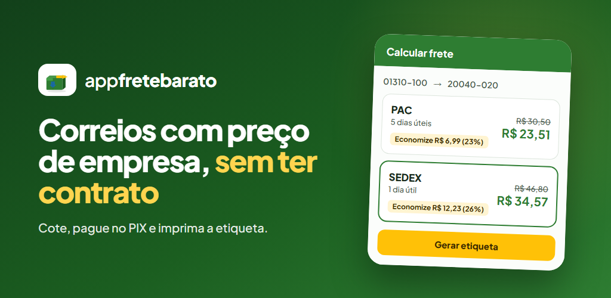
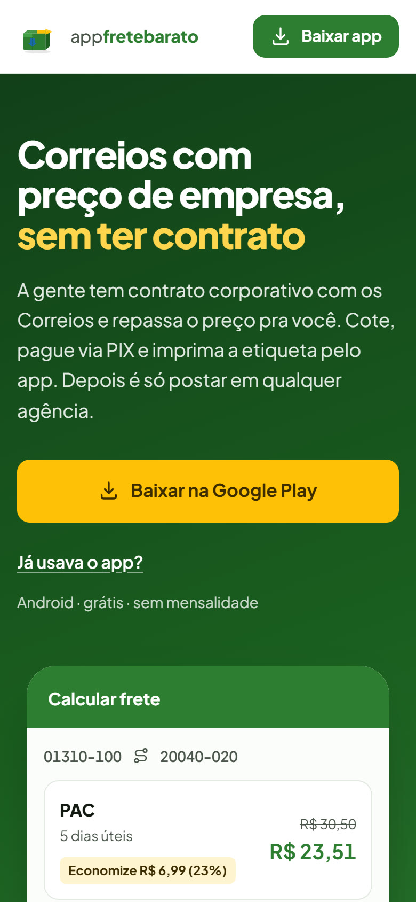
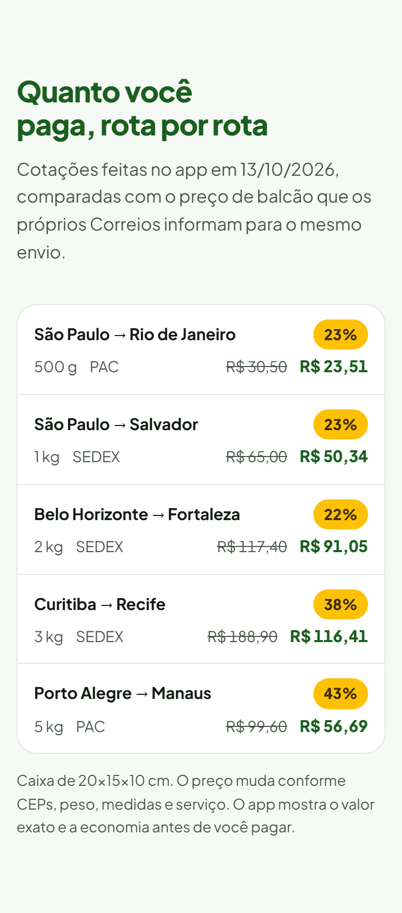
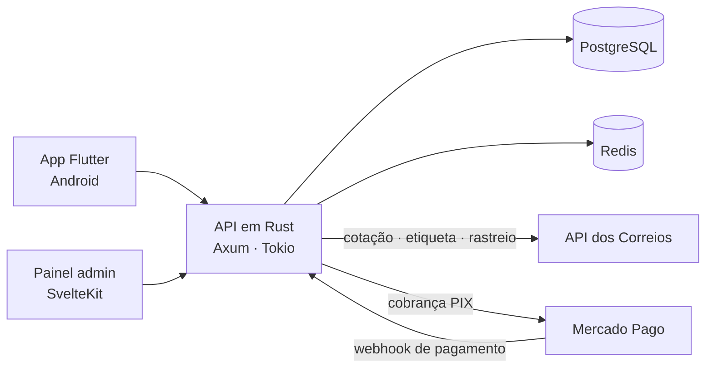

# App Frete Barato: Correios com preço de empresa, sem ter contrato

> **Cliente:** Miranda Multimarcas
> **Entrega:** [AtosSofts](https://atossofts.com.br) · **Em produção:** [appfretebarato.com.br](https://appfretebarato.com.br) · [Google Play](https://play.google.com/store/apps/details?id=br.com.appfretebarato)
> **Código:** privado (propriedade do cliente). Este repositório mostra só a arquitetura e as funcionalidades.

---

## O problema

Quem vende pela internet envia pelos Correios quase todo dia, mas **só empresa com contrato paga o preço corporativo**. O pequeno vendedor paga o preço de balcão, preenche a declaração de conteúdo à mão e perde tempo na fila da agência.

## A solução

Um **produto completo**, publicado na Google Play, que repassa o preço do contrato corporativo da Miranda Multimarcas para qualquer pessoa: **cote, pague no PIX e imprima a etiqueta**. Depois é só deixar a caixa em qualquer agência.

| Rota (cotação de 13/10/2026) | Balcão | No app | Economia |
|---|---|---|---|
| São Paulo → Rio de Janeiro · 500 g · PAC | R$ 30,50 | **R$ 23,51** | 23% |
| São Paulo → Salvador · 1 kg · SEDEX | R$ 65,00 | **R$ 50,34** | 23% |
| Belo Horizonte → Fortaleza · 2 kg · SEDEX | R$ 117,40 | **R$ 91,05** | 22% |
| Curitiba → Recife · 3 kg · SEDEX | R$ 188,90 | **R$ 116,41** | 38% |
| Porto Alegre → Manaus · 5 kg · PAC | R$ 99,60 | **R$ 56,69** | 43% |

Caixa de 20×15×10 cm, comparada com o preço de balcão informado pelos próprios Correios. Fonte: [appfretebarato.com.br](https://appfretebarato.com.br).

  
  &nbsp;&nbsp;
  

---

## O que o app faz

- **Cotação na hora** de PAC e SEDEX, mostrando quanto o usuário economiza em relação ao balcão
- **Pagamento por PIX** (Mercado Pago) ou com **saldo de carteira** pré-paga, para pagar várias etiquetas com um único PIX
- **Etiqueta + declaração de conteúdo eletrônica**, no padrão dos Correios, para impressora térmica 100×150 ou folha A4
- **Cancelamento** de etiqueta ainda não postada, com o valor de volta como saldo
- **Rastreio** com a linha do tempo dos Correios e **leitura do código de barras pela câmera**
- **Catálogo de produtos** (peso e medidas) e **agenda de destinatários**, para digitar menos e errar menos
- Compartilhamento de etiqueta e cotação em PDF pelo WhatsApp, e-mail ou app da impressora
- **Sincronização automática** do status das etiquetas (postada, em trânsito...) com os Correios
- **Login por biometria** e painel administrativo para a operação

---

## Arquitetura

**Por que Rust?** A API precisa ser rápida e confiável, porque mexe com dinheiro (carteira, PIX, estorno) e com a integração dos Correios, sem margem para erro. Rust entrega desempenho de linguagem de sistemas com segurança de memória.

**Entrega contínua:** GitHub Actions compila o app (AAB para a Play Store) e publica a API, o painel admin e a landing page.

## Stack

`Flutter` `Riverpod` `go_router` `mobile_scanner` `local_auth` `pdf` · `Rust` `Axum` `Tokio` `SQLx` `PostgreSQL` `Redis` `JWT` · `SvelteKit` `Tailwind` · `API dos Correios` `Mercado Pago (PIX)` · `GitHub Actions`

## Resultados

<!-- {{preencher com números reais autorizados pelo cliente, ex.: usuários ativos, etiquetas emitidas por mês, economia total repassada}} -->
*Em breve.*

---

**Tem uma ideia de app que é o próprio negócio?** → [WhatsApp](https://wa.me/5587996032135?text=Ol%C3%A1%20Dimmi%2C%20vi%20seu%20GitHub%20e%20quero%20conversar%20sobre%20um%20projeto.) · [contato@atossofts.com.br](mailto:contato@atossofts.com.br) · [atossofts.com.br](https://atossofts.com.br) · [LinkedIn](https://www.linkedin.com/in/dimmisueg/)

🇺🇸 Production Android app that resells corporate Brazilian Postal Service (Correios) shipping rates to anyone: instant quotes, PIX payments, prepaid wallet, printable labels with electronic content declaration, tracking with barcode scanning. Flutter + Rust (Axum) + PostgreSQL + Redis + SvelteKit admin. Client code is private.
